# GroundValue — proposed solution for Hero Housing Problem Statement 1
Submission working draft, 7 November 2026. Requirement source: [official challenge deck](https://docs.google.com/presentation/d/1TRd67oaFJUE5jlbIFhi199VV2B7_E3q5/edit).
**Implemented today:** an evidence-backed apartment asking-price research prototype.
**Proposed next:** a transaction-trained, explainable valuation engine with lender review. No claim of measured AVM superiority is made.

## 1. Market scope
Start with residential apartments in Electronic City, Bengaluru, where the prototype already collects listing evidence. Next expand within Bengaluru once transaction labels and geographic coverage can be verified, followed by additional cities selected for lawful data availability and independent validation coverage. Each new city must pass its own evaluation gate; changing a city string is not geographic validation.

Introduce commercial offices and retail as separate segments, using tenure, usable area, rent roll, occupancy, lease expiry, operating income and local yield evidence. Compare income-capitalization and sales-comparison baselines for commercial assets; do not reuse an apartment model without validation. Nationwide expansion uses state-specific record adapters, consistent schemas and regional models where data distributions differ.

## 2. Data and linkage
| Input | Collection / cleaning | Merge key and use | Current status |
|---|---|---|---|
| Portal listings | Existing source automation; normalize INR, units and area basis; dedupe canonical URLs and repeated attributes; preserve retrieval timestamp | Candidate comparable with explicit source and exclusion reason | Implemented; asking prices, not registered sales |
| Registered transactions | Licensed/authorized lender or registration data; validate deed date, consideration, area, transfer type and outliers | Parcel/building ID + address + geocode + date; supervised price label after quality review | Proposed; access not secured |
| Government records | Permitted state registration/cadastral/municipal sources; preserve jurisdiction and record date | Parcel/title/property linkage with confidence and human resolution of conflicts | Proposed; guidance values are contextual features, not assumed market prices |
| Geospatial/infrastructure | Licensed maps and official project/open-data sources with citations | Coordinates and distance/travel-time features; completion status as of valuation date | Proposed |
| Satellite imagery | Licensed imagery; cloud/date/coverage checks | Georeferenced property buffer; built density/land cover features | Proposed; ablation required before assuming predictive benefit |
| Trends/property attributes | Time-stamped market series and verified area, age, floor, condition, tenure, amenities | Common property schema and as-of feature snapshot | Basic user area/bedrooms implemented; remaining features proposed |

Retain raw evidence and provenance separately from normalized features. Use exact parcel IDs where possible; fuzzy address matches need a confidence threshold and review. Never silently merge ambiguous properties. Keep train/serving unit conversions and area definitions identical. Unknown data stays missing with an indicator; do not manufacture facts. Every dataset added to the submission needs a concrete citation, license/access basis, time coverage and limitation.

## 3. Model and evidence of accuracy
Target verified transaction consideration (log price), conditioned on valuation date and property segment. Use a regularized hedonic model as a transparent baseline and gradient-boosted trees as a candidate for nonlinear interactions. Features: area/basis, bedrooms, age, floor, condition, tenure, coordinates/neighborhood, amenity accessibility, infrastructure status and lagged market measures. Imagery features are optional until their incremental gain is demonstrated.

The existing median asking-rate method remains a research baseline, not ground-truth fair market value. Exclude target-derived price-per-sq-ft and post-sale information from predictors. Group duplicate units/buildings across splits; fit imputation, encoders and normalization only on training data.

Evaluation protocol:
1. Freeze a cleaned, licensed transaction dataset and a data manifest.
2. Train on older transactions, tune on a later validation period, and keep the newest period untouched for final testing.
3. Add held-out neighborhood/city testing to measure geographic transfer, with no shared buildings.
4. Compare hedonic, comparable-sales and candidate ML models on the SAME eligible records; compare a third-party AVM only if its historical/as-of predictions and evaluation rights are available.
5. Report sample counts, coverage, INR MAE, median absolute percentage error, RMSE, R², and errors by city/type/price band; report uncertainty on metric differences using grouped resampling.
6. Calibrate prediction intervals on a separate calibration split and measure empirical coverage and width on the held-out test.
7. Require evidence of improvement and acceptable subgroup behavior before expanding scope. Define deployment thresholds with the lender before examining final test outcomes.

**Results today: not measured.** Transaction labels, a trained model, calibrated intervals and external AVM benchmark predictions are not present. A design-only comparison cannot establish superior accuracy.

## 4. Explainable output
Current output: median comparable asking-rate × target area; lower/upper quartiles of comparable rates applied to target area; accepted/rejected evidence with reasons. The band describes observed asking prices and is not a statistical confidence interval.

Proposed lender valuation report:
- Fair-market-value prediction, currency/date/area basis, calibrated prediction interval and actual validation coverage for the relevant segment.
- Main model factors with contribution direction/magnitude; local comparables and links. Model attributions explain the model, not causality.
- Evidence completeness, freshness, geographic support, disagreement and out-of-distribution flags.
- Immutable input snapshot, source citations, dataset/model/policy versions and timestamps.
- Reviewer identity, decision, reason and any override preserved alongside the original model output.

When evidence is inadequate or out of scope, return insufficient evidence/referral instead of inventing a confident number.

## 5. Automation and scale
Current local flow: property input → validated source request → background research → normalization/filtering → deterministic estimate → persistent history/export.

Proposed production architecture:

```mermaid
flowchart LR
  A[Property request] --> B[Scope and access checks]
  B --> C[Job queue]
  C --> D[Authorized source adapters]
  D --> E[Raw evidence and provenance]
  E --> F[Property linkage and quality checks]
  F --> G[Versioned as-of features]
  G --> H[Segment valuation model]
  H --> I[Calibration and explanations]
  I --> J[Evidence and risk gates]
  J --> K[Lender review and audit report]
```

Use durable queues, idempotent requests, worker retries with bounded budgets, source-specific throttling, cached reusable observations and asynchronous status. Separate source outages from model uncertainty. Add tenant isolation, authentication, encrypted secrets, access logs and retention controls before external use. Monitor extraction yield, evidence coverage, latency/cost, drift, interval coverage and realized error once actual outcomes arrive. Benchmark turnaround on representative workloads; no latency SLA is currently proven.

## 6. Lender workflow and risk
1. Analyst submits the property reference and available documents under the lender's access controls.
2. Engine validates scope, collects evidence, resolves identity and reports missing/conflicting inputs.
3. Engine supplies value/uncertainty only when appropriate; otherwise refers for additional evidence or physical valuation.
4. Lender applies its own versioned collateral and loan policies. Flag stale evidence, wide intervals, unusual properties, title/area inconsistencies, out-of-distribution features and inadequate transaction support.
5. Qualified reviewer records acceptance, request for further evidence, or referral to a physical valuer; preserve the original output and reasons.
6. Track agreement with independent valuations, exceptions, turnaround and subsequent outcomes during a supervised pilot.

Present prototype outputs as analyst research. Listing evidence alone does not establish collateral value, title validity, borrower eligibility or credit approval. Regulatory fit must be reviewed against applicable current requirements and the lender's policies before operational use; this draft does not claim certification or automatic compliance.

## Presentation/demo sequence
1. Problem, initial scope and six-requirement map.
2. Data provenance and proposed architecture.
3. Working prototype: input, genuine source trace, accepted/excluded records, estimate/insufficiency, saved history and export.
4. Model/evaluation design with results explicitly marked pending.
5. Proposed lender report, referral cases and audit workflow.
6. Expansion gates, limitations and next validation milestones.

Cite the official challenge, the actual portal URLs displayed by the prototype, and each additional dataset/library used in the final submission. Do not reuse the TinyFish pitch as if it demonstrates trained valuation accuracy.
